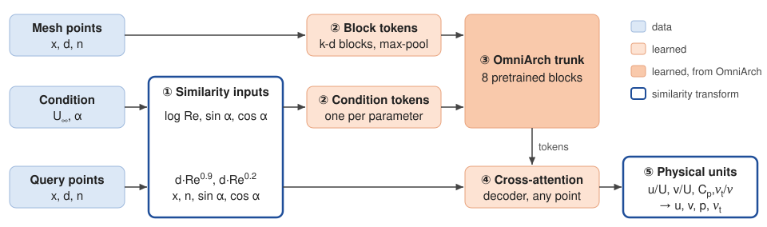

# OmniArch-Aero

English | [中文](README_zh.md)

Similarity specialization of the OmniArch PDE foundation model for flow and heat transfer
fields beyond the training range.

## Abstract

*Draft of the paper in preparation.*

Computational fluid dynamics underpins the design of aircraft and engines, where every
candidate design must be evaluated across many operating conditions. Such workloads require
surrogate models that are both fast and extrapolable, accurate at conditions beyond the
training range. However, current methods trade one for the other. Numerical solvers compute
each condition from the governing equations, but each run takes minutes to hours, and at
extreme conditions the solution may fail to converge or lose accuracy. Neural operators, in
contrast, predict in milliseconds but degrade once the Reynolds number or temperature leaves
the training range. Dimensional analysis has long reduced such problems to a few similarity
variables, but typically for scalar quantities rather than full fields on unstructured
meshes. In this work, we introduce similarity specialization, which rewrites the inputs and
outputs of a pretrained PDE foundation model in the similarity variables of the governing
equations. As in wind-tunnel testing, where similarity parameters carry scale-model
measurements to full-scale flight, these variables carry what is learned at training
conditions to new ones, and the model learns only the scale effects that the similarity law
leaves out. In similarity variables, extrapolation in physical parameters largely reduces to
interpolation. We present OmniArch-Aero, which tokenizes unstructured meshes into spatial
blocks, reads them with the pretrained OmniArch backbone, and decodes fields at arbitrary
points through cross-attention. On Reynolds-number extrapolation in AirfRANS, OmniArch-Aero
lowers the lift-coefficient error by 91% relative to the best published model and predicts
each flow field in 0.22 s, compared with about 25 min for the RANS solver. These results
suggest a principle for physics-aware foundation models: learn in similarity variables, not
in physical units.

<sub>The 91% compares with published models on their 454-case protocol; the table below
uses all 496 test cases.</sub>



The physical inputs are rewritten in similarity variables (①). The mesh becomes block tokens
and the condition becomes one token per parameter (②). The pretrained OmniArch trunk reads
the sequence (③), any point of the domain is answered by cross-attention to it (④), and the
outputs are mapped back to physical units (⑤). AirfRANS variables are shown; the blade task
is described [below](#similarity-specialization).

## Results

AirfRANS, Reynolds task: train on Re in [3e6, 5e6] (504 cases), test on 496 cases outside it.
Relative L2 error of the lift coefficient, official post-processing, seeds 0, 1, 2.

| model | C_L relative L2 | Spearman rho_L |
|---|---|---|
| OmniArch-Aero (similarity specialization) | **0.0182 +- 0.0026** | 0.9996 |
| same model, dimensional inputs and outputs | 0.0514 +- 0.0038 | |

Cooled turbine blade, inlet temperature extrapolation: train on 600 / 800 / 1000 K model
conditions and two auxiliary cases, test on 1200 K and on the 1616 K engine condition.
Mean absolute error of the metal temperature over all 3.3 M solid nodes; OmniArch-Aero is the
node-wise mean of seeds 0-4.

| method | 1200 K | 1616 K |
|---|---|---|
| OmniArch-Aero | **1.56 K** | **4.90 K** |
| theta prior alone (node-wise linear in Tg, no model) | 1.84 K | 5.34 K |
| similarity conversion (theta copied from 1000 K) | 5.32 K | 20.96 K |

## Quick start

```bash
pip install -r requirements.txt
mkdir -p weights && cp /path/to/omniarch-base.pt weights/   # OmniArch-base, see the OmniArch release

# AirfRANS: unpack Dataset.zip to data/airfrans/raw/Dataset first
bash scripts/prepare_airfrans.sh
bash scripts/train_airfrans.sh 0                # repeat for seeds 1, 2
bash scripts/eval_airfrans.sh airfrans 0 1 2

# blade: data/blade/extracted holds the decoded CFX cases (data/blade/README.md)
bash scripts/prepare_blade.sh
bash scripts/train_blade.sh 0                   # repeat for seeds 1-4
bash scripts/eval_blade.sh 0 1 2 3 4
```

On a Slurm cluster, wrap any of them: `bash scripts/slurm.sh gpu scripts/train_blade.sh 0`
(`cpu` for the prepare scripts). One RTX 5090 trains AirfRANS in about 1.4 h and the blade in
about 1.7 h.

## Files

| file | content |
|---|---|
| `model.py` | `AeroNet`: block tokens, OmniArch trunk, cross-attention decoder; `load_omniarch` |
| `train.py` | single-GPU training loop for either task, configured by `config/*.py` |
| `predict.py` | full-field prediction, optionally the mean of several seeds |
| `evaluate.py` | metrics against the truth (the only script that reads test truth) |
| `tasks/airfrans.py` | AirfRANS features, similarity variables, batches, official lift and drag |
| `tasks/blade.py` | blade features, theta prior, batches, temperature metrics |
| `tasks/__init__.py` | task interface and the k-d block partition |
| `data/*/prepare.py` | raw data to `data/*/processed` |
| `config/*.py` | the three reported configurations |
| `scripts/*.sh` | prepare, train, evaluate, Slurm submission |

## Model

For one case (a geometry under one condition):

1. **Block tokens.** The mesh points are split into K blocks of equal size by a k-d tree
   (K = 2048 for AirfRANS, 4096 for the blade). A point MLP is max-pooled inside each block and
   mapped to the model width, and a Fourier code of the block center is added.
2. **Condition tokens.** One summary token and one token per normalized condition parameter.
3. **Trunk.** 8 pre-norm transformer blocks of width 1024 (16 heads, SwiGLU 2816), copied
   from the first 8 blocks and the final norm of OmniArch-base (103 M of the 114 M parameters).
4. **Decoder.** Each query point is embedded from its own features, attends once to the whole
   sequence, and an MLP head gives the outputs. Encoding is done once per case; any number of
   points is decoded in chunks.

Loss: mean squared error in normalized output space. AdamW, cosine schedule, bf16 autocast.

### Algorithm

The core of `model.py`, `train.py` and `predict.py`, with the step numbers of the figure.

```python
# encode: one case -> token sequence                                  (model.AeroNet.encode)
h      = point_mlp(points)                        # (M, 128), M mesh points
pooled = scatter_max(h, block_index, K)           # (K, 128), one row per k-d block       ②
block  = block_mlp(pooled) + pos_mlp(fourier(block_centers))
cond   = param_mlp(params) + param_type           # one token per similarity parameter  ①②
tokens = trunk([summary; cond; block])            # 8 OmniArch blocks + final norm          ③

# decode: any set of points                                           (model.AeroNet.decode)
y = head(cross_attention(q_embed(query_features), tokens))                               # ④

# one training step                                                   (train.py)
for _ in range(gradient_accumulation_steps):      # 4 for AirfRANS, 1 for the blade
    case, Q = task.get_batch()                    # AirfRANS: all wall points + 8000 volume points
    y   = decode(query_features(case, Q), encode(case))
    loss = weighted_mse(y, similarity_targets(case, Q))  # wall x5, pressure x2 (AirfRANS)
    (loss / gradient_accumulation_steps).backward()
clip_grad_norm(1.0); adamw.step()                 # warmup, then cosine decay

# inference                                                           (predict.py)
tokens = encode(case)                             # once per case
y      = concat(decode(chunk, tokens) for chunk in points)
field  = to_physical(y, case)                                                           # ⑤
field  = mean over seeds
```

## Similarity specialization

**AirfRANS.** The condition is (log10 Re, sin a, cos a) instead of (U, a). Wall distance
enters as y+ ~ d Re^0.9 (viscous sublayer) and delta ~ d Re^0.2 (outer layer). The outputs
are u/U, v/U, Cp and log10(1 + nu_t/nu), mapped back to physical units before scoring:
u = U (u/U), p = U^2 Cp / 2, nu_t = nu (10^y - 1). Wall points get loss weight 5 and pressure
weight 2.

**Blade.** The target is theta = (Tg - T) / (Tg - Tc), which the similarity law keeps fixed
across conditions with the same similarity numbers; the condition tokens are five similarity
numbers. Theta still drifts with temperature level, mainly because material and gas properties
depend on temperature. A prior theta_lin, the node-wise straight line of theta against Tg over
the 600 / 800 / 1000 K cases, absorbs most of that drift; the model reads theta_lin as an extra
input and outputs the correction, with a zero-initialized last layer so that training starts
from the prior itself. For a training case inside the prior set, theta_lin is fitted without it.

```python
theta_lin = a + b * Tg / 1000                     # node-wise least squares over 600/800/1000 K
d_theta   = decode([features, theta_lin], tokens) # zero at the start of training
T         = Tg - (theta_lin + d_theta) * (Tg - Tc)
```

## Relation to the original experiment code

The numbers above come from the original experiment scripts (November 2026). This repository
is a rewrite of the same method; its checkpoints use the same parameter names.
See [VERIFY.md](VERIFY.md) for the checks of this code against those numbers.
