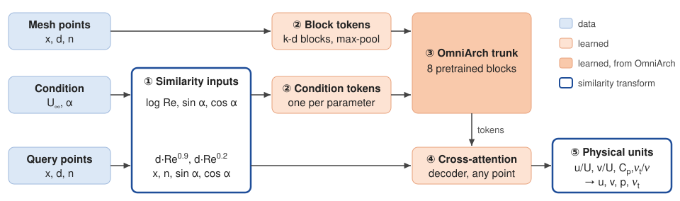

# OmniArch-Aero

[English](README.md) | 中文

对 OmniArch PDE 基础模型做相似特化，预测训练范围以外工况的流场和温度场。

## 摘要

*论文摘要草稿，英文原文见 [README.md](README.md)。*

计算流体力学支撑着飞机和发动机的设计，每个候选方案都要在多个工况下评估。这就要求代理模型既快又能外推，在训练范围以外的工况上也算得准。现有方法往往顾此失彼。数值求解器从控制方程出发逐个工况求解，但每次计算要几分钟到几小时，在极端工况下还可能不收敛或失准。神经算子的预测只需毫秒，但雷诺数或温度一旦超出训练范围，精度就明显下降。量纲分析早已把这类问题归结为少数几个相似变量，但通常只用于标量，没有用到非结构网格上的全场。本文提出相似特化，用控制方程的相似变量改写预训练 PDE 基础模型的输入和输出。风洞试验靠相似参数，把缩比模型的测量结果换算到全尺寸飞行。相似特化的道理与此相同，这些变量把训练工况上学到的规律带到新工况，模型只需学习相似律没有覆盖的尺度效应。在相似变量下，物理参数上的外推大体变成了内插。我们据此构建 OmniArch-Aero，把非结构网格切成空间块作为 token，用预训练的 OmniArch 主干读入，再通过交叉注意力在任意点解码物理场。在 AirfRANS 雷诺数外推任务上，OmniArch-Aero 的升力系数误差比已发表的最好模型低 91%，单个流场预测用时 0.22 s，RANS 求解器约需 25 min。这些结果为物理感知的基础模型提出一条原则：在相似变量中学习，而不是在物理单位中学习。

<sub>91% 是在已发表模型采用的 454 个算例协议上比较的；下面的表格用全部 496 个测试算例。</sub>



物理输入先改写成相似变量（①）。网格切块变成块 token，工况每个参数变成一个 token（②）。预训练的 OmniArch 主干读入整个序列（③），区域内任意一点通过交叉注意力读取这个序列得到输出（④），输出再换算回物理单位（⑤）。图中是 AirfRANS 的变量，叶片任务见[后文](#相似特化)。

## 结果

AirfRANS 雷诺数任务：在 Re ∈ [3e6, 5e6] 的 504 个算例上训练，在范围以外的 496 个算例上测试。指标是升力系数的相对 L2 误差，用官方后处理，种子 0、1、2。

| 模型 | C_L 相对 L2 | Spearman rho_L |
|---|---|---|
| OmniArch-Aero（相似特化） | **0.0182 ± 0.0026** | 0.9996 |
| 同一模型，输入输出用有量纲物理量 | 0.0514 ± 0.0038 | |

冷却涡轮叶片，进口温度外推：在 600 / 800 / 1000 K 缩比工况和两个辅助算例上训练，在 1200 K 和 1616 K 发动机工况上测试。指标是全部 330 万个固体节点上金属温度的平均绝对误差。OmniArch-Aero 取种子 0 到 4 的逐节点平均。

| 方法 | 1200 K | 1616 K |
|---|---|---|
| OmniArch-Aero | **1.56 K** | **4.90 K** |
| 只用 θ 先验（逐节点对 Tg 线性拟合，不用模型） | 1.84 K | 5.34 K |
| 相似换算（直接沿用 1000 K 的 θ） | 5.32 K | 20.96 K |

## 快速上手

```bash
pip install -r requirements.txt
mkdir -p weights && cp /path/to/omniarch-base.pt weights/   # OmniArch-base 权重，见 OmniArch 发布页

# AirfRANS：先把 Dataset.zip 解压到 data/airfrans/raw/Dataset
bash scripts/prepare_airfrans.sh
bash scripts/train_airfrans.sh 0                # 种子 1、2 同样再跑
bash scripts/eval_airfrans.sh airfrans 0 1 2

# 叶片：data/blade/extracted 放解码后的 CFX 算例（见 data/blade/README.md）
bash scripts/prepare_blade.sh
bash scripts/train_blade.sh 0                   # 种子 1 到 4 同样再跑
bash scripts/eval_blade.sh 0 1 2 3 4
```

在 Slurm 集群上，任何一个脚本都可以这样提交：`bash scripts/slurm.sh gpu scripts/train_blade.sh 0`（预处理脚本用 `cpu`）。一张 RTX 5090 上，AirfRANS 训练约 1.4 h，叶片约 1.7 h。

## 文件

| 文件 | 内容 |
|---|---|
| `model.py` | `AeroNet`：块 token、OmniArch 主干、交叉注意力解码器；`load_omniarch` |
| `train.py` | 单卡训练循环，两个任务共用，由 `config/*.py` 配置 |
| `predict.py` | 全场预测，可取多个种子的平均 |
| `evaluate.py` | 对照真值算指标（唯一读取测试真值的脚本） |
| `tasks/airfrans.py` | AirfRANS 特征、相似变量、取批、官方升阻力计算 |
| `tasks/blade.py` | 叶片特征、θ 先验、取批、温度指标 |
| `tasks/__init__.py` | 任务接口和 k-d 分块 |
| `data/*/prepare.py` | 原始数据转成 `data/*/processed` |
| `config/*.py` | 报告中的三组配置 |
| `scripts/*.sh` | 预处理、训练、评测、Slurm 提交 |

## 模型

一个算例指一个几何在一个工况下的解。

1. **块 token。** 用 k-d 树把网格点等分成 K 块（AirfRANS 取 2048，叶片取 4096）。逐点 MLP 的输出在块内取最大值，再映射到模型宽度，加上块中心的 Fourier 编码。
2. **工况 token。** 一个汇总 token，加上每个归一化工况参数各一个 token。
3. **主干。** 8 层 pre-norm Transformer，宽度 1024，16 头，SwiGLU 2816。参数取自 OmniArch-base 的前 8 层和最后的 norm，占全部 1.14 亿参数中的 1.03 亿。
4. **解码器。** 每个查询点由自身特征嵌入，对整个序列做一次交叉注意力，再经 MLP 输出。每个算例只编码一次，任意多的点分块解码。

损失是归一化输出空间里的均方误差。优化器 AdamW，余弦学习率，bf16 混合精度。

### 算法

下面是 `model.py`、`train.py` 和 `predict.py` 的主干逻辑，编号和图中对应。

```python
# 编码：一个算例 -> token 序列                                         (model.AeroNet.encode)
h      = point_mlp(points)                        # (M, 128)，M 个网格点
pooled = scatter_max(h, block_index, K)           # (K, 128)，每个 k-d 块一行              ②
block  = block_mlp(pooled) + pos_mlp(fourier(block_centers))
cond   = param_mlp(params) + param_type           # 每个相似参数一个 token             ①②
tokens = trunk([summary; cond; block])            # 8 层 OmniArch 加最后的 norm            ③

# 解码：任意一组点                                                     (model.AeroNet.decode)
y = head(cross_attention(q_embed(query_features), tokens))                               # ④

# 一步训练                                                             (train.py)
for _ in range(gradient_accumulation_steps):      # AirfRANS 取 4，叶片取 1
    case, Q = task.get_batch()                    # AirfRANS：全部壁面点加 8000 个体网格点
    y   = decode(query_features(case, Q), encode(case))
    loss = weighted_mse(y, similarity_targets(case, Q))  # AirfRANS 壁面权重 5，压力权重 2
    (loss / gradient_accumulation_steps).backward()
clip_grad_norm(1.0); adamw.step()                 # 先线性预热，再余弦衰减

# 推理                                                                 (predict.py)
tokens = encode(case)                             # 每个算例一次
y      = concat(decode(chunk, tokens) for chunk in points)
field  = to_physical(y, case)                                                           # ⑤
field  = 各种子取平均
```

## 相似特化

**AirfRANS。** 工况用 (log10 Re, sin α, cos α) 表示，不用 (U, α)。壁面距离以 y+ ~ d Re^0.9（黏性底层）和 δ ~ d Re^0.2（外层）的形式进入。输出是 u/U、v/U、Cp 和 log10(1 + νt/ν)，评分前换算回物理单位：u = U (u/U)，p = U² Cp / 2，νt = ν (10^y − 1)。壁面点的损失权重为 5，压力为 2。

**叶片。** 目标量是无量纲温度 θ = (Tg − T) / (Tg − Tc)。相似数相同的工况之间，相似律保证 θ 不变。工况 token 用五个相似数。θ 仍会随温度水平漂移，主要因为材料和燃气的物性随温度变化。先验 θ_lin 是 θ 对 Tg 在 600 / 800 / 1000 K 三个算例上的逐节点直线拟合，能吸收大部分漂移。模型把 θ_lin 作为额外输入，输出修正量。最后一层零初始化，训练从先验本身出发。训练算例本身属于先验集时，拟合 θ_lin 时把它留出。

```python
theta_lin = a + b * Tg / 1000                     # 在 600/800/1000 K 上逐节点最小二乘
d_theta   = decode([features, theta_lin], tokens) # 训练开始时为零
T         = Tg - (theta_lin + d_theta) * (Tg - Tc)
```

## 与原始实验代码的关系

上面的数字来自原始实验脚本（2026 年 11 月）。本仓库是同一方法的重写，权重的参数名保持一致。本代码与这些数字的核对见 [VERIFY.md](VERIFY.md)。
